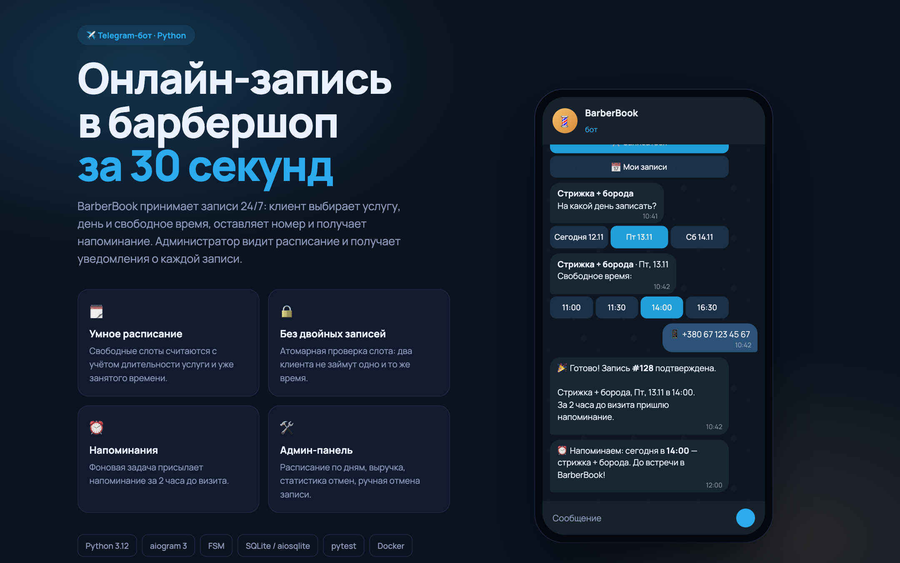

# BarberBook — Telegram-бот онлайн-записи

**Витрина проекта:** https://shelt00n.github.io/barberbook-bot/



Бот для барбершопа или салона красоты: клиенты записываются на услугу в пару касаний, администратор видит расписание и получает уведомления. Проект демонстрационный, но готов к запуску: нужен только токен от @BotFather.

## Возможности

**Для клиента**
- Каталог услуг с ценой и длительностью.
- Выбор дня (ближайшие 7 рабочих дней) и **только свободного** времени.
- Номер телефона — кнопкой «Отправить номер» или вручную, с валидацией.
- Экран подтверждения, список своих записей, отмена в один клик.
- Напоминание за 2 часа до визита.

**Для администратора** (`/admin`)
- Расписание на любой день с навигацией ◀️ ▶️ и суммой выручки.
- Статистика за 7 дней: новые записи, отмены, доля отмен.
- Уведомления о новых записях и отменах, `/cancel_booking <id>` с оповещением клиента.

## Технические решения

- **aiogram 3**: роутеры, FSM для пошаговой записи, типизированные `CallbackData`.
- **Чистая логика слотов** (`bot/slots.py`) отделена от Telegram и покрыта тестами.
- **Защита от двойной записи**: проверка пересечений и вставка выполняются атомарно.
- **Внедрение зависимостей**: `Database` и `Settings` прокидываются в хендлеры через `Dispatcher`.
- **Фоновые напоминания**: asyncio-задача, устойчивая к ошибкам и заблокировавшим бота пользователям.
- **Тексты отдельно от кода** (`bot/texts.py`), чтобы заказчик сам правил формулировки.

## Стек

`Python 3.12` · `aiogram 3` · `SQLite (aiosqlite)` · `pytest + pytest-asyncio` · `Docker`

## Запуск

```bash
git clone https://github.com/Shelt00n/barberbook-bot.git
cd barberbook-bot
cp .env.example .env          # вставьте BOT_TOKEN и свой Telegram ID в ADMIN_IDS
python3.12 -m venv .venv && source .venv/bin/activate
pip install -r requirements.txt
python -m bot
```

Через Docker:

```bash
docker compose up -d --build
```

Тесты:

```bash
pip install -r requirements-dev.txt
pytest -q        # 9 passed
```

## Структура

```
bot/
  __main__.py      — запуск, DI, фоновые напоминания
  config.py        — настройки и список услуг
  slots.py         — расчёт свободного времени (чистые функции)
  db.py            — слой данных на aiosqlite
  keyboards.py     — клавиатуры и CallbackData
  texts.py         — все тексты сообщений
  handlers/user.py — сценарий клиента (FSM)
  handlers/admin.py— панель администратора
tests/test_core.py — тесты слотов, двойной записи, отмен и напоминаний
```

---
Автор: **Егор Кинаш** — разработка Telegram-ботов под ключ. Нужен бот для записи, продаж или поддержки? Пишите на Freelancehunt.
